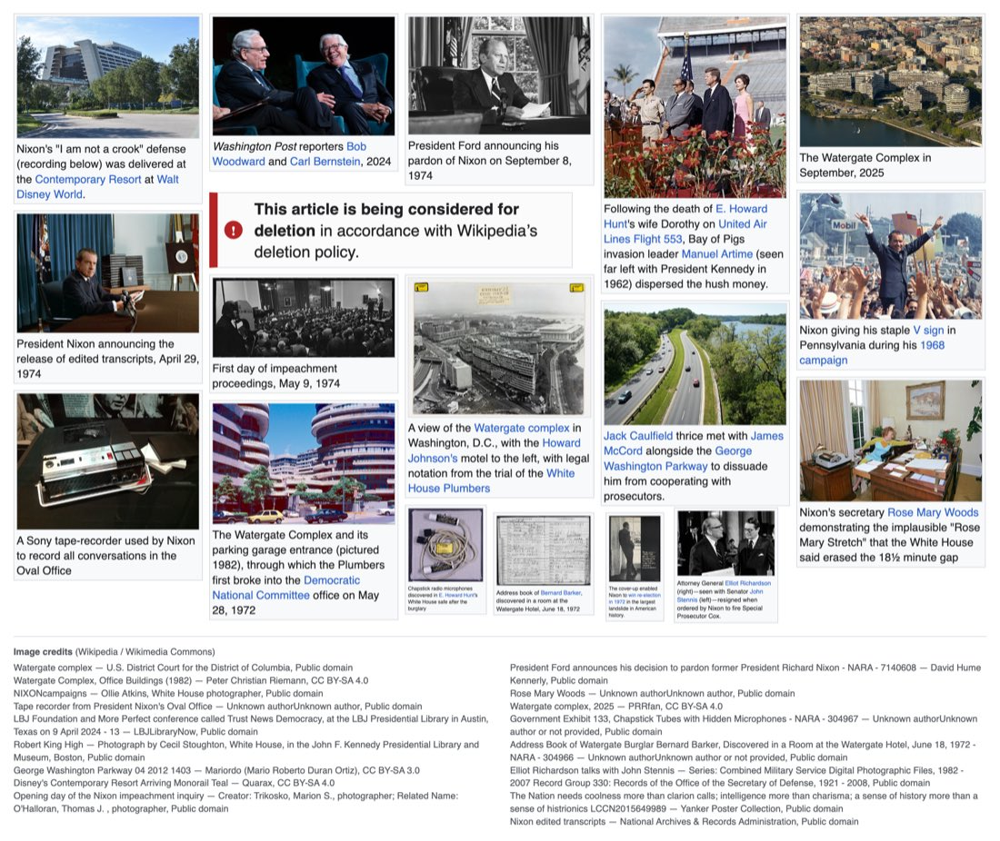
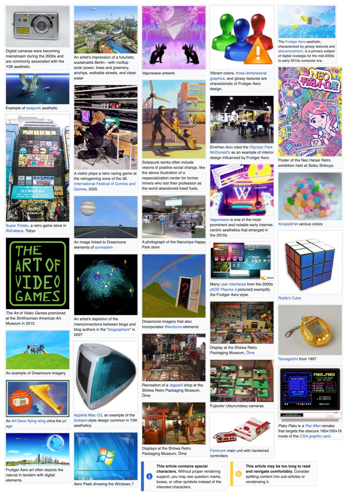

# Wikiposter

**Build dense, Wikipedia-style image posters from Wikipedia articles, right in your browser.**

**Live site:** [wikiposter.pages.dev](https://wikiposter.pages.dev/)

Search for a topic or paste an English Wikipedia article link, choose images with their original captions, and arrange them on a poster. Export a PNG or copy a share link. Wikiposter is a single HTML file; it has no build step or server-side account.

## Examples

<table>
  <tr>
    <td width="50%" valign="top"></td>
    <td width="50%" valign="top"></td>
  </tr>
  <tr>
    <td><em>Watergate</em></td>
    <td><em>Retro technology and internet aesthetics</em></td>
  </tr>
</table>

The examples show images and captions sourced from Wikipedia and Wikimedia Commons. Each source image has its own license; check its file page before reusing or publishing a poster.

## What you can do

- **Find images:** Search by topic, paste a Wikipedia article URL, try a suggested topic, open random articles, or find similar articles. Captioned images appear by default; you can include images without captions.
- **Build a poster:** Click images to add them. Drag tiles, resize from the blue corner, edit captions, auto-arrange, shuffle, change layer order, and use undo or redo. The poster saves automatically in your browser.
- **Add Wikipedia-style elements:** Insert editable notice boxes and a blank infobox, or fetch an article's infobox.
- **Choose a layout:** Let the poster grow, or use square, A2 portrait, or 24 × 36 in portrait proportions. The fixed presets are layout shapes, not a guarantee of print resolution.
- **Share and export:** Download a PNG, optionally with an image credits strip; copy image credits as text; or copy a compressed share link containing the layout.

## Getting started

1. [Open the live editor](https://wikiposter.pages.dev/).
2. Search for a topic or paste an English Wikipedia article URL.
3. Open an article and click an image to add it to the poster.
4. Drag and resize tiles, then choose **Download PNG** or **Copy share link**.

To run the supplied source locally, open [`index.html`](index.html) in a current browser. Wikipedia API requests and the export library require an internet connection. For share links that work on other devices, use the hosted site.

### Controls

| Action | How |
| --- | --- |
| Add an image | Click its thumbnail in the article panel |
| Move or resize | Drag a tile, or pull its blue lower-right corner |
| Edit a caption | Click the caption |
| Remove or reorder | Use the controls revealed when hovering over a tile |
| Undo or redo | Toolbar buttons or `Ctrl/Cmd+Z` and `Ctrl/Cmd+Shift+Z` (`Ctrl+Y` also redoes) |
| Repack | **Auto-arrange**; **Shuffle** changes the order before repacking |

## How it works

Wikiposter uses the English Wikipedia API to discover articles, images, captions, and infoboxes. A browser-based layout packs tiles on a 1200 px-wide board. It stores the current poster in local storage and puts shared layouts in a compressed URL fragment. PNG export uses [html2canvas 1.4.1](https://html2canvas.hertzen.com/) from cdnjs. The app uses plain HTML, CSS, and JavaScript in [`index.html`](index.html).

To deploy this repository on Cloudflare Pages, serve the repository root as static files with no build command. `index.html` is the entry point. The live deployment is [wikiposter.pages.dev](https://wikiposter.pages.dev/).

## Limits and attribution

- Wikipedia and Wikimedia Commons files have individual licenses. Some Wikipedia images are non-free and may not be reusable outside their articles. Check each file page before publishing, printing, or selling a poster. **Copy credits** and the optional PNG credits strip help collect attribution; they do not grant reuse rights.
- Source images may be too small for sharp large-format prints. The A2 and 24 × 36 presets control proportions only.
- Tile controls depend on hover, so editing on touch devices can be awkward. The app currently uses English Wikipedia only.
- Share links can become too long for some messaging apps. PNG export needs the cdnjs library to load and can fail when an image blocks cross-origin rendering.

Wikiposter is an independent project and is not affiliated with or endorsed by the Wikimedia Foundation.
